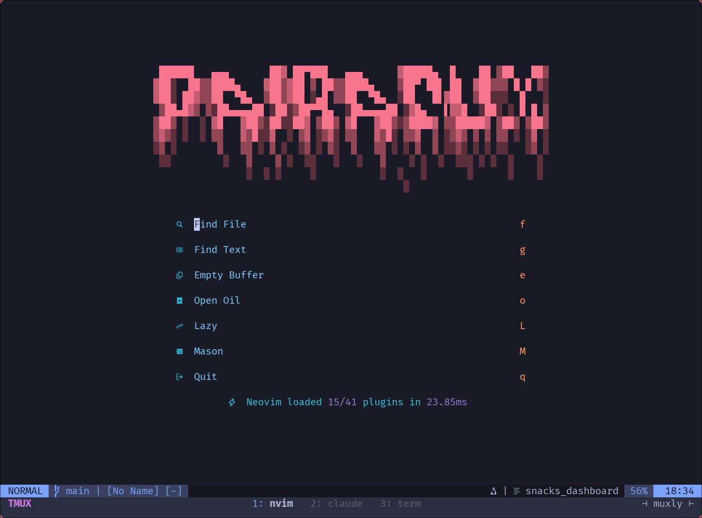

Most people open a terminal when they have to. I prefer to just stay in it. My setup of choice is Arch Linux running Hyprland, with Neovim for editing, tmux for session management, and a growing collection of tools I've built to smooth out the rough edges. I graduated from Valdosta State University in May 2026 and now work as a full stack developer. Outside of work, most of my time goes into writing Go for problems that sit close to the metal, with some C when the job calls for it.

### If It's Tedious, Automate It

Muxly came from frustration. I was juggling tmux sessions across multiple projects, and the existing session managers were either too opinionated or too rigid. Everything wanted you to work their way, with minimal room to customize. So I wrote one in Go that handles it the way I always thought it should work. It's open source, it's picked up forks and community interest, and it scratches an itch that a lot of terminal-heavy developers share.

That same instinct drives most of what I build. Gametrak started simple enough: poll `hyprctl clients` every few seconds, check if a game window is open, log the time. It would've worked fine. The performance overhead would've been negligible. But the idea of polling on a timer just to hack something out bothered me enough that I went down the rabbit hole of learning Hyprland's IPC socket system instead. Now Gametrak hooks directly into window open/close events, which is both cleaner and exactly the kind of problem I wanted to solve in the first place. Even this portfolio site is built from scratch rather than slapped together with a template. If I'm going to put my name on something, I want to understand every layer of it.

### Leading a Team, Learning the Tradeoffs

Right now my biggest project is Lapse, a Flutter flashcard app I'm leading as my senior seminar capstone. I'm project manager of a four-person team, and we're implementing the FSRS spaced repetition algorithm with a local-first architecture and Supabase cloud sync. It's a different kind of challenge than solo systems work. Coordinating across a team means making decisions about architecture tradeoffs early and living with them. The experience has sharpened how I think about software design when other people have to read, extend, and depend on your code.

### More Than the Commit History

Outside of coursework and personal projects, I work as a Network Student Assistant at VSU. That means troubleshooting connectivity issues, managing access points, running cable, and finding ways to make routine maintenance less routine. I also spent a good chunk of college tutoring classmates in CS concepts, unpaid, just because watching someone finally get a concept they've been struggling with is genuinely satisfying. Gaming is what pulled me into tech in the first place. I still play strategy games like RimWorld, but now half the fun is analyzing the systems underneath. How does the AI make decisions? How do mods hook into the engine? What makes a simulation feel alive? And somewhere in the background, I'm exploring voice acting, because apparently having a deep voice is a marketable skill if you know what to do with it.

### What I'm Looking For

I want to work on systems that matter. Infrastructure, embedded systems, DevOps, developer tooling. Anything where I'm close to Linux, solving real problems, and building things that make other engineers more productive. The open source ecosystem shaped how I think about software, and I want to keep contributing to that world professionally. I'm finishing my degree with a concentration in cybersecurity and a strong foundation in theory of computation, but my heart is in building well-crafted tools that people actually want to use.
